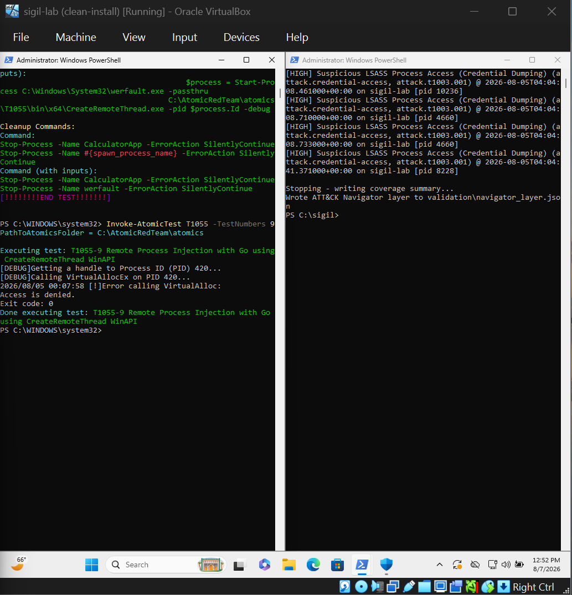

# Projects

<h2 id="Sigil">Sigil</h2>

A real-time detection engine. It evaluates Sigma rules against live Windows
Sysmon telemetry, correlates related events across processes into scored alerts
mapped to MITRE ATT&CK, and exports ATT&CK Navigator layers. It covers six
techniques, all validated in an isolated lab against live Atomic Red Team attack
simulations.

Since then I added a CI pipeline that runs the tests on every push, replay
tests that push recorded telemetry through the whole engine and check what it
flags, and two more rules, scheduled task creation and ingress tool transfer.
Both are now validated live too. The lab VM had gone stale between rounds, so
the new rules had nothing to fire against until I copied the files back over.
A possible future add-on, Linux coverage alongside Windows.

Most recently I scored it against 278 recorded public attack logs and about 27
hours of my own normal activity. It caught 5 of 34 labeled samples at first and
21 of 34 after I fixed two telemetry format bugs. False alarms on the normal
day went from 12 to 2. The LOLBin rule is still the weak one. The
[write-up](/writing/scoring-sigil-against-data-i-didnt-write/) has the details
and the numbers are in the repo.

[github.com/noah-fage/sigil](https://github.com/noah-fage/sigil)

<h2 id="sentinel">Sentinel</h2>

A SOC analytics dashboard built with FastAPI and React. Logs go to the Claude
API in a single call with extended thinking and schema-enforced JSON output. It
returns intrusion pattern, privilege escalation, and data exfiltration findings
mapped to MITRE ATT&CK, each with cited evidence and a 0 to 100 risk score.
It then projects the attacker's likely next moves and countermeasures. The
backend is on Render and the frontend is on Vercel.

[sentinel-anomaly.vercel.app](https://sentinel-anomaly.vercel.app) &middot;
[github.com/noah-fage/log-anomaly-detector](https://github.com/noah-fage/log-anomaly-detector)

<h2 id="iot">IoT attack-injection testbed</h2>

I'm a student researcher in Prof. Carol Fung's group at Concordia. The goal is
a labeled dataset of attacks against IoT devices, since not much of it exists.
I built a configurable tool that picks an attack, a target and some parameters,
runs it against an emulated device (IoTGoat in QEMU), and records whole-device
system calls, CPU and memory, and network traffic for the run. So far it does
port scans and SYN floods. I'm extending it to more attack types and to other
devices.

The results are unpublished, so they stay off this page.

<h2 id="rover">Rover UI and video pipeline</h2>

On the McGill Robotics rover team I moved live camera video from a TCP WebSocket
to a GStreamer WebRTC/UDP pipeline for low-latency teleoperation. Getting it
stable meant tracing a chain of six separate problems across the pipeline
configuration, port mismatches, and frontend race conditions. I also fixed the
GPS navigation page for competition and set up the interface so it can run on
several computers at once. I've been on the team since January and was recently
made the UI System Manager, so now I also run the weekly UI meetings and connect
people across divisions.

